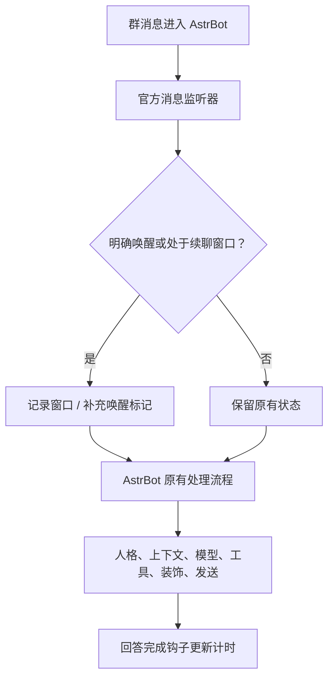

# 注意力优化插件

AstrBot 群聊续聊插件。被唤醒后，同一成员可以在限定时间内继续交谈，无需每条消息都带唤醒词。

插件仅在有效窗口内设置 `event.is_at_or_wake_command = True`。人格、上下文、模型与工具调用、结果装饰、分段和发送继续由 AstrBot 及原有插件处理。

## 运行要求

- AstrBot `>=4.29.1,<5`，已配置聊天模型。
- 当前声明并验证的消息平台为 `aiocqhttp`（OneBot v11，包括 NapCat 接入）。
- Python 3.10 或更高版本，无额外运行依赖。

## 安装

在 AstrBot 插件页选择通过仓库链接安装：

```text
https://github.com/lociere/astrbot_plugin_attention
```

将本项目打包得到的 ZIP 上传至 AstrBot WebUI 的插件本地安装入口，确认插件加载成功，再打开插件配置。

也可将项目目录放入 `data/plugins/astrbot_plugin_attention/`，确保 `main.py`、`metadata.yaml` 和 `_conf_schema.json` 位于该目录根层，然后通过官方插件管理重载。配置由 AstrBot 保存在自己的 `data/config/` 目录中。

## 工作方式

1. 用户以当前 AstrBot 配置中的非空唤醒前缀、@机器人或引用机器人消息明确呼叫；以核心已经判定为唤醒为前提。
2. 插件开启该成员的续聊窗口，默认 90 秒，从这次明确唤醒开始计时。
3. 窗口内普通消息补充唤醒标记。仅收到消息不会延长窗口。
4. 默认在模型完成回答后续时，普通回复发送阶段结束后再续时；关闭续时选项可使用固定窗口。
5. 超时后不再补充标记，后续消息恢复 AstrBot 原有唤醒规则。

窗口按 **平台实例、机器人账号、群、成员** 四项分别隔离。甲唤醒后，乙的消息不会因此获得续聊资格。状态只在内存保存，重载或重启后清空；过期记录按需清理，并设置容量上限。



## 配置

| 配置项 | 默认值 | 作用 |
|---|---|---|
| `enabled` | `true` | 总开关 |
| `window_seconds` | `90` | 窗口长度，1—3600 秒 |
| `refresh_on_reply` | `true` | 回答后重新计时；关闭则从最近一次明确唤醒固定计时 |
| `allowed_groups` | `[]` | 额外限制生效群，可填写群号或完整 UMO；空列表不额外限制 |
| `ignore_addressed_to_others` | `true` | 不为 @其他人、@全体或引用他人的消息补充唤醒；同时明确呼叫本机器人时仍可处理 |
| `allow_media` | `true` | 允许窗口内纯表情、图片、语音等消息获得续聊资格 |
| `max_sessions` | `1000` | 最多保留的窗口数，1—10000；超出后淘汰最早到期的窗口 |

唤醒词沿用 AstrBot 实际会话配置，本插件不设置另一套词库或正则。原生唤醒前缀按消息开头匹配；如需使用名称唤醒，请在 AstrBot 唤醒前缀中添加对应名称。

要实现“未唤醒不主动回复”，还应在相应 AstrBot 配置文件中关闭 **群聊上下文感知 → 主动回复**，并检查其他主动唤醒插件。群聊消息记录注入可以保留。插件不会自行修改全局配置，也不会阻止其他来源已经触发的回复。

## 处理边界

- **只补充唤醒**：不调用模型或发送 API，不返回消息结果，不修改原文、消息链、提示词、人格或历史；不取消已有唤醒，不停止事件传播。
- **指令保留原有分派**：依据核心已匹配的指令处理器跳过，不因命令回复开启窗口。`/你好` 这类未匹配指令的普通前缀聊天仍按核心规则开启窗口。窗口内单独说 `reset` 不会因此变成 `/reset` 指令。
- **原有规则仍有效**：私聊、白名单、权限、自定义规则、内容检查、插件禁用和 LLM 开关由 AstrBot 处理。群成员的窗口隔离只影响唤醒资格，不改变核心的群聊历史是否按成员隔离。
- **面向他人的消息只跳过补充**：若核心已因 @全体等条件判定唤醒，本插件不会撤销。若希望核心忽略 @全体，需要在 AstrBot 对应配置中另外设置。
- **纯媒体沿用原链路**：是否理解或回复表情、图片和语音，仍取决于 AstrBot、模型与媒体插件能力。
- **窗口不判断语义对象**：同一成员转而对别人说话却没有 @、引用等标记时，窗口内仍可能触发回复。无需额外模型调用的计时策略有这一边界。
- **计时依据不是送达回执**：模型回答钩子及普通发送后的框架钩子用于续时，不能保证 QQ 端实际送达。4.29.1 的流式输出不经过普通发送后钩子，使用模型回答钩子续时；直接调用平台 API 的纯工具消息不单独续时。已过期、淘汰或重载前的窗口不会被迟到回复重新激活。

监听器优先级为 `sys.maxsize - 1`，位于内置会话控制之后、默认群聊上下文与概率回复处理之前。这样续聊消息会先得到唤醒标记，避免再进入原生概率回复分支。该顺序按 AstrBot 4.29.1 源码核验；与其他高优先级唤醒插件共同使用时，应分别检查它们是否也生成回复或改动事件。

## 开发与验证

```bash
python -m pip install -r requirements-dev.txt
python -m unittest discover -s tests -p 'test_*.py' -v
ruff check .
ruff format --check .
python tools/package.py
```

`tests/sdk_smoke.py` 需要在安装了 AstrBot 4.29.1 的环境运行。它使用真实 SDK、核心消息处理阶段和群聊概率判定，替换外部模型和平台为内存测试对象，不连接聊天平台或模型服务。

```bash
python tests/sdk_smoke.py
```

## 开发依据

- [AstrBot 官方插件模板](https://github.com/Soulter/helloworld)
- [插件开发指南](https://docs.astrbot.app/dev/star/plugin-new.html)
- [消息监听、优先级与事件钩子](https://docs.astrbot.app/dev/star/guides/listen-message-event.html)
- [插件配置规范](https://docs.astrbot.app/dev/star/guides/plugin-config.html)
- [4.29.1 事件与唤醒标记](https://github.com/AstrBotDevs/AstrBot/blob/v4.29.1/astrbot/core/platform/astr_message_event.py)
- [4.29.1 核心处理阶段](https://github.com/AstrBotDevs/AstrBot/blob/v4.29.1/astrbot/core/pipeline/process_stage/stage.py)
- [4.29.1 内置群聊处理](https://github.com/AstrBotDevs/AstrBot/blob/v4.29.1/astrbot/builtin_stars/astrbot/main.py)

## 许可

[MIT](LICENSE)
